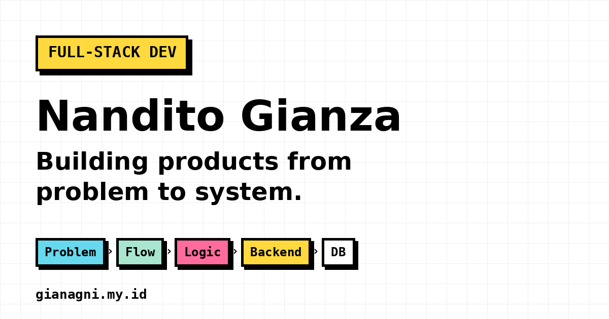

<div align="center">

<a href="https://gianagni.my.id/">
  
</a>

<br />

<a href="https://gianagni.my.id/"></a>
<a href="https://github.com/gianagni"></a>
<a href="https://www.linkedin.com/in/nanditogianza"></a>

<p><strong>Personal portfolio • Developer experiments • Systems thinking</strong></p>

<p>A home for the things I build, the problems behind them, and the decisions that turn an idea into a working system.</p>

<p><a href="https://gianagni.my.id/"><strong>Live Site</strong></a> &nbsp;·&nbsp; <a href="https://gianagni.my.id/#work"><strong>Featured Work</strong></a> &nbsp;·&nbsp; <a href="https://gianagni.my.id/projects.html"><strong>All Projects</strong></a> &nbsp;·&nbsp; <a href="https://gianagni.my.id/terminal.html"><strong>Interactive Terminal</strong></a></p>

</div>

---

## `01 / ABOUT THIS REPOSITORY`

I'm **Nandito Gianza**, a Full-Stack Developer based in Jakarta, Indonesia.

I like starting with the *why* before touching the *how*: understanding the user, mapping the workflow, defining business rules, and building the interface, backend, and data layer around them.

This repository is the **source code for my personal portfolio website**. It is not a monorepo containing the source of every product featured on the site.

```text
PROBLEM  >  USER FLOW  >  BUSINESS RULES  >  SYSTEM DESIGN  >  BUILD  >  TEST  >  SHIP
```

## `02 / FEATURED WORK`

| Project | Focus | Explore |
| :--- | :--- | :--- |
| **Flowprint** | Experimental, local-first CLI that helps developers find their way around unfamiliar JavaScript and TypeScript repositories. | [Source & Docs](https://github.com/gianagni/flowprint) |
| **Lahena** | Career readiness mapping, skill-gap analysis, and actionable mini-project recommendations for students. | [Live Website](https://lahena.vercel.app/) |
| **NG Market** | Digital product marketplace with checkout, verification, and order fulfillment workflows. | [Live Website](https://market.gianagni.my.id/) |
| **DiscloseKit** | Structured responsible disclosure reports, ethical checks, and browser-based PDF export. | [Live Website](https://disclosekit.gianagni.my.id/) · [Source](https://github.com/gianagni/disclosekit) |

The portfolio also documents earlier experiments and projects in development, including **Lummix** and **Seikarsa**. See the [project archive](https://gianagni.my.id/projects.html).

> [!NOTE]
> The animated terminals shown in Featured Work are **illustrative workflow demos**, not live access to those projects or reproductions of their actual source code.

## `03 / WHAT'S INSIDE`

- **Neo-brutalist interface.** Bold outlines, offset shadows, strong typography, and a light grid-inspired visual language.
- **Animated project showcases.** Code-style panels that explain each product through a different workflow.
- **Interactive terminal.** Explore portfolio commands, a weather lookup powered by Open-Meteo, and a few playful extras.
- **Project case studies.** Dedicated pages for selected work and an archive of earlier builds.
- **Responsive design.** Layouts adapted for desktop and mobile, with reduced-motion considerations for animations.

### Built with

The **portfolio website itself** is intentionally lightweight:


No application framework or build step is required for the portfolio. The featured products themselves use different technologies, such as Next.js, TypeScript, Supabase, Node.js, and SvelteKit.

## `04 / RUN IT LOCALLY`

```bash
git clone https://github.com/gianagni/portofolio.git
cd portofolio
python -m http.server 5500
```

Open **http://localhost:5500/** in your browser. Alternatively, use a local static file server such as VS Code Live Server.

The site uses browser-side JavaScript and some external resources, so an internet connection is needed for features such as live weather data and hosted fonts.

### Try the terminal

Open [`terminal.html`](terminal.html) and enter:

```text
help
projects
weather jakarta
game
matrix
```

The weather command uses [Open-Meteo](https://open-meteo.com/), without embedding an OpenWeatherMap API key.

## `05 / REPOSITORY MAP`

```text
portofolio/
├── index.html                 # Main portfolio
├── projects.html              # Project archive
├── terminal.html              # Interactive terminal
├── neo-styles.css             # Main visual system
├── neo-sections.css           # Featured work and section layouts
├── script.js                  # Website and terminal interactions
├── featured-terminal.js       # Project showcase animations
├── image/                     # UI assets
└── images/projects/           # Project images and portfolio cover
```

Individual project detail pages live alongside `index.html` in the repository root.

## `06 / LET'S CONNECT`

Have an interesting problem, a product idea, or a codebase worth untangling?

**[Website](https://gianagni.my.id/)** · **[GitHub](https://github.com/gianagni)** · **[LinkedIn](https://www.linkedin.com/in/nanditogianza)** · **[Email](mailto:nanditogianza@gmail.com)**

<div align="center">

---

<sub>Designed and built by <a href="https://github.com/gianagni">Nandito Gianza</a>.</sub>

<sub><strong>Building products from problem to system.</strong></sub>

</div>
